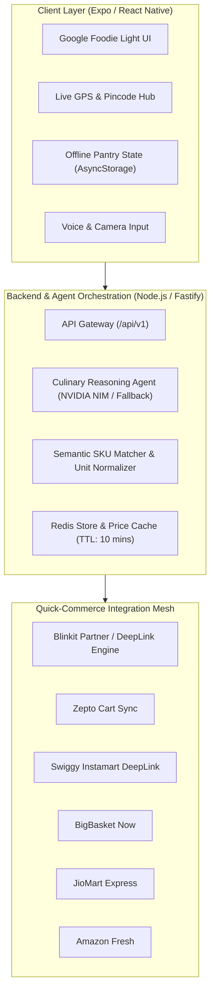

# Dish to Basket · Master Product & Engineering Plan

> **Vision**: Transform "Dish to Basket" from a culinary concept into the go-to consumer platform that bridges food inspiration with instant 10-minute grocery delivery across India.

---

## 1. Executive Summary & Core Value Proposition

Today, home cooking faces a friction bottleneck:
1. **Inspiration**: You want to cook a dish (e.g. *Paneer Butter Masala* or *Chicken Biryani*).
2. **Friction**: You don't know the exact quantities, package sizes, or which store near your house has everything in stock at the lowest price.
3. **Manual Shopping**: You spend 20 minutes opening Blinkit, Zepto, and Instamart separately, typing 10 ingredients one by one.

**Dish to Basket solves this in 10 seconds**:
- Enter any dish name, craving, or recipe photo.
- The app determines the exact ingredients scaled to your guest count.
- It filters out staples you already have at home.
- It compares the total basket price across 6 fast delivery stores in your pincode.
- **1 Tap** opens the pre-filled basket or auto-dispatches the order for 10-minute delivery.

---

## 2. End-to-End System Architecture

---

## 3. The 4-Phase Master Execution Roadmap

### Phase 1: Core Consumer Polish & Mobile App Release (Weeks 1–3)
- [ ] **Native App Packaging (EAS Build)**: Generate production `.apk` and iOS TestFlight builds using Expo Application Services.
- [ ] **Voice Recipe Search**:
  - Voice Mic button for hands-free queries (e.g. *"I want to make Kadai Paneer for 3 people"*).
- [ ] **Persistent Home Pantry Manager**:
  - A dedicated "My Kitchen Pantry" screen where users check off spices, oils, flour, and salt once, so they are never re-ordered accidentally.
- [ ] **Native Deep-Link Protocol**:
  - Support direct mobile app launch (`blinkit://`, `zepto://`, `swiggy://`) with automatic web fallback.

### Phase 2: Live Quick-Commerce Automation & Multi-Cart Sync (Weeks 4–7)
- [ ] **Real-Time Pincode Inventory Engine**:
  - Query store availability by pincode to prevent showing out-of-stock items.
- [ ] **Split-Basket Optimizer**:
  - Suggest when splitting an order between two 10-minute stores saves more than ₹150 (e.g., Vegetables from Blinkit, Dairy from Zepto).
- [ ] **1-Click Cart Injection**:
  - Explore browser extension / accessibility service / store affiliate APIs to inject all items directly into the store's cart without manual searching.

### Phase 3: Interactive Chef Companion Mode (Weeks 8–10)
- [ ] **Step-by-Step Cooking Mode**:
  - Once ingredients arrive, tap **"Start Cooking"**.
  - Displays large, distraction-free cooking steps with built-in timers (e.g. *"Simmer for 15 minutes"* with a single-tap countdown).
  - Hands-free voice navigation (*"Next step"* / *"Repeat"*).
- [ ] **Nutritional & Macro Dashboard**:
  - Automatic calculation of calories, protein, carbs, and fat per serving based on the exact purchased grocery items.

### Phase 4: Growth, Community & Monetization (Weeks 11+)
- [ ] **Weekly Meal Prep & Consolidated Basket**:
  - Plan Monday to Friday dinners in 1 click; the app merges all ingredients into one consolidated weekly grocery order.
- [ ] **Affiliate & Brand Monetization**:
  - Integrate affiliate links for Blinkit, Zepto, Swiggy Instamart, and Amazon Fresh (1.5% to 5% commission on gross merchandise value).
  - Sponsored ingredient placements (e.g., *"Amul Butter"* featured badge).

---

## 4. Key Engineering Milestones for Production

| Component | Current State | Production Target |
| :--- | :--- | :--- |
| **Theme & UI** | Google Foodie Light Mode with background banners | Polished Material 3 + iOS Liquid Glass with fluid micro-animations |
| **Grocery Imagery** | Curated high-res Unsplash food photography | Dynamic retail product pack shots with brand logos |
| **Store Links** | Consolidated search URLs + individual links | Direct cart pre-fill via partner APIs & deep links |
| **AI Backend** | Stepfun Step-5 / NVIDIA NIM with free fallback | Multi-tiered edge routing with Redis response caching |
| **Favorites** | Stored locally in AsyncStorage | Cloud sync with user accounts (Google Sign-In / Apple ID) |

---

## 5. Immediate Next Actions

1. **Deploy to Mobile**: Run `eas build -p android --profile preview` to generate a downloadable APK that can be tested on real phones.
2. **Add Voice Search**: Integrate speech recognition so non-tech users can simply speak their meal requests.
3. **Pantry Manager**: Add a 1-tap "My Pantry Staples" screen so salt, oil, and basic spices are saved once and excluded automatically.
